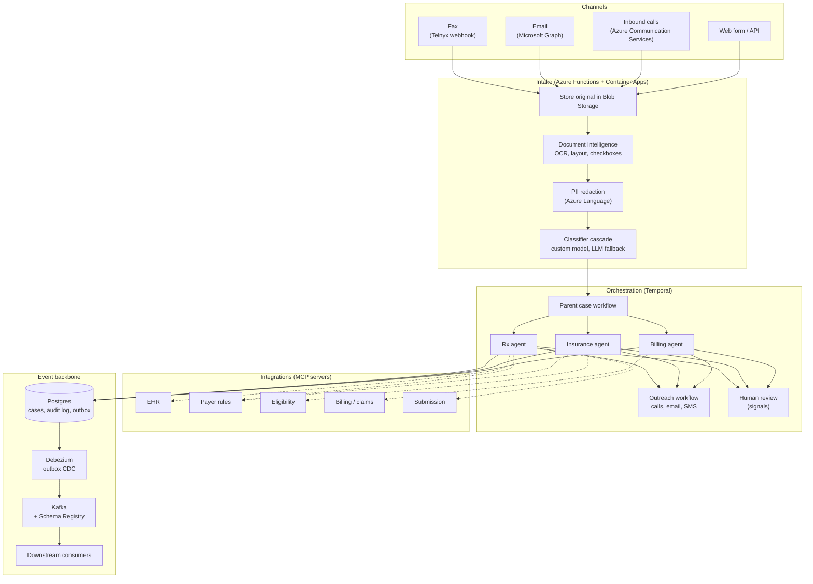
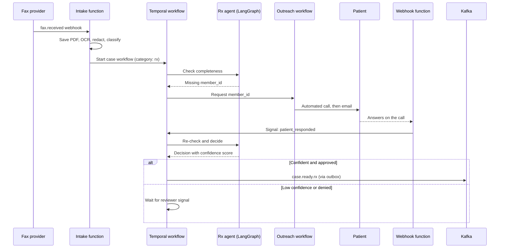

# healthcare-intake-triage
# Healthcare Intake Triage

Healthcare intake that sorts incoming requests into prescription, insurance, or billing cases, follows up by phone and email when information is missing, and sends completed cases downstream.

> **Status:** Work in progress. The prior authorization pipeline (CrewAI agents, MCP servers, confidence gate, audit log, evaluation gate) is working today. The classifier, specialist agents, outreach, Temporal orchestration, and Kafka streaming are being built now. See the [roadmap](#roadmap) for what's done and what's next.

---

## Why this exists

Healthcare offices get a steady stream of requests by fax, email, and phone. Some are prior authorizations for prescriptions, some are insurance questions, and some are billing problems. Many arrive with something missing, like a member ID or a diagnosis code, and staff spend hours sorting them and chasing down the details.

This project automates that work. It reads each request, figures out what kind of case it is, and hands it to a specialist agent for prescriptions, insurance, or billing. If anything is missing, it calls or emails the patient or provider to ask for it, then picks up where it left off once they reply. Anything the system isn't confident about goes to a person for review instead of being guessed. Finished cases are published to Kafka so other systems can act on them.

## What it does

1. **Takes in requests from any channel.** Faxes, emails, phone calls, and web forms all become the same internal case format.
2. **Reads documents.** Scanned faxes go through OCR. Digital PDFs and form fields are read directly, with no OCR needed.
3. **Protects patient data.** Personal information is redacted before text reaches a language model or the event stream.
4. **Classifies the case.** A fast custom classifier handles clear cases, and a language model handles the hard ones. A single request can be more than one type, for example a billing problem caused by an insurance lapse.
5. **Routes to a specialist agent.** Prescription, insurance, and billing each have their own agent, tools, and rules for what "complete" means.
6. **Chases missing information.** The system calls, emails, or texts to ask for exactly the fields it needs, then waits for the answer, for days if necessary.
7. **Keeps a person in the loop.** Low confidence results and high stakes actions wait for a human decision.
8. **Publishes finished cases.** Completed cases are streamed to Kafka for downstream systems.
9. **Records everything.** Every tool call, decision, and routing outcome is written to an audit log.

---

## Architecture



The system is organized in layers, and each layer has one job.

| Layer | Responsibility | Built with |
|---|---|---|
| Channels | Receive requests wherever they arrive | Telnyx fax webhooks, Microsoft Graph, Azure Communication Services |
| Intake | Store the original, extract text, redact PII, classify | Azure Functions, Azure AI Document Intelligence, Azure Language |
| Orchestration | Own the case lifecycle, including waits, retries, timeouts, and approvals | Temporal |
| Agents | Reason about one case type at a time | LangGraph |
| Integrations | Give agents a standard way to reach external systems | MCP servers |
| Events | Publish finished cases reliably to downstream systems | Postgres outbox, Debezium, Kafka, Schema Registry |

### Who owns state

Three tools in this stack can run long workflows, so each one has a clearly defined role. Without that, two systems would eventually disagree about where a case stands.

- **Temporal owns the case lifecycle.** Anything that waits hours or days lives here: patient callbacks, email replies, retries, escalations, and human approvals.
- **LangGraph owns reasoning.** Classifying, checking completeness, and running the agent steps happen inside a single Temporal activity and finish in seconds to minutes.
- **Azure Functions stay small.** They receive webhooks (fax arrived, call ended, email reply received) and send signals to Temporal. They hold no state of their own.

---

## Case lifecycle

Here's what happens when a prior authorization fax arrives without the patient's member ID.



---

## The agents

Each specialist agent is its own Temporal child workflow running its own LangGraph graph. Agents never call each other directly. If one discovers the case belongs elsewhere, it returns a reroute result to the parent workflow, which starts the right agent. Reroutes are capped so a case can't bounce back and forth forever.

| Agent | Handles | MCP servers | Review threshold |
|---|---|---|---|
| **Rx** | Prior authorizations, medication coverage, clinical criteria | EHR, payer rules, eligibility, submission | Strict. Submitting on a provider's behalf is the highest stakes action in the system. |
| **Insurance** | Coverage checks, member ID problems, plan changes, coordination of benefits | Eligibility, payer rules | Moderate |
| **Billing** | Claim status, copays, statements, payment disputes | Billing / claims | Lower, since a wrong answer is easier to correct |

Each agent defines its own Pydantic schema for a complete case. A billing dispute needs an invoice number and date of service. A prior authorization needs an NDC, prescriber NPI, and diagnosis codes. When fields are missing, the outreach scripts are generated from that schema, so the system always asks for exactly what it needs.

---

## Classification

Classification uses two tiers.

1. **Custom text classifier (Azure Language).** Fast, cheap, multi-label, and returns a confidence score for each category.
2. **LLM fallback with structured output.** Handles low confidence and mixed cases.

If both tiers are unsure, the case goes to human review.

The classifier is built in reverse order on purpose. It starts with the LLM alone, and every prediction and human correction is logged. That log becomes the training data for the custom classifier, so the fast tier learns from real cases instead of hand-labeled examples.

---

## Human in the loop

Human review is implemented with Temporal signals, not prompts.

- A workflow that needs a decision waits on a condition with a timeout.
- The review UI sends a signal such as `reviewer_decision` with the reviewer's choice.
- Timeouts give escalation for free. If nobody responds in time, the workflow sends a reminder, tries another channel, or routes the case to a supervisor.

The confidence gate itself is plain Python. Whether a decision is submitted automatically or sent to a person is a hard-coded rule, never another model call.

---

## Event streaming

Completed cases reach Kafka through the **transactional outbox pattern**. Agents write the case update and its event to Postgres in the same transaction, and Debezium publishes the outbox rows to Kafka. This prevents the classic bug where the database update succeeds but the Kafka publish fails, or the other way around.

| Topic | Published when |
|---|---|
| `case.received` | A request enters the system |
| `case.classified` | The classifier assigns one or more categories |
| `case.info_requested` | Outreach starts for missing fields |
| `case.ready.rx` | A prescription case is complete |
| `case.ready.insurance` | An insurance case is complete |
| `case.ready.billing` | A billing case is complete |
| `case.dead_letter` | An event could not be processed after retries |

Events are keyed by `case_id`, so every event for a case lands on the same partition in order. Schemas are generated from the Pydantic models and registered in Schema Registry. Consumers are idempotent and use retry topics before anything reaches the dead letter topic.

---

## Tech stack

| Area | Choice |
|---|---|
| Agents | LangGraph |
| Orchestration | Temporal (Python SDK) |
| Tool integration | Model Context Protocol (MCP) servers |
| LLMs | Claude in Microsoft Foundry or Azure OpenAI |
| Classification | Azure Language custom text classification with LLM fallback |
| Document processing | Azure AI Document Intelligence |
| PII redaction | Azure Language PII detection |
| Calls, email, SMS | Azure Communication Services |
| Inbound email | Microsoft Graph change notifications |
| Fax | Telnyx Programmable Fax |
| Event streaming | Apache Kafka, Schema Registry, Debezium |
| Database | PostgreSQL |
| Cache | Redis (payer rules) |
| API | FastAPI |
| Compute | Azure Container Apps, Azure Functions |
| Secrets | Azure Key Vault with managed identity |
| Observability | OpenTelemetry, Application Insights, Langfuse |
| Infrastructure | Bicep |
| CI/CD | GitHub Actions with an evaluation gate |

---

## Getting started

### Prerequisites

- Python 3.11+
- Docker and Docker Compose
- An LLM API key (see `config.env.example`)

### Run locally

Temporal, Kafka, Schema Registry, Debezium, Kafka UI, Postgres, and Redis all run locally with Docker Compose, so local development costs nothing.

```bash
# Start the infrastructure
docker compose up -d

# Install the project
pip install -r requirements.txt
pip install -e .

# Configure
cp config.env.example config.env   # then fill in your keys

# Start the API
uvicorn prior_auth.api:app --reload --port 8000

# Start the Temporal worker (in another terminal)
python -m prior_auth.worker
```

Useful local dashboards:

| Service | URL |
|---|---|
| API docs | http://localhost:8000/docs |
| Temporal UI | http://localhost:8233 |
| Kafka UI | http://localhost:8080 |

### Simulate a fax

You don't need a real fax line for development. The fake fax script posts the same webhook payload a real provider would, using sample documents from `data/samples/`.

```bash
python scripts/fake_fax.py data/samples/pa_form_scanned.pdf
```

---

## Testing and evaluation

```bash
pytest
```

Tests never touch real external services. Pipeline tests mock at the function boundary, cache tests use `fakeredis`, and schema tests check the Pydantic guardrails directly.

**Golden dataset gate.** The evaluation step runs in CI and blocks deployment if accuracy drops below the threshold.

```bash
python -c "
from prior_auth.evaluation import evaluate_golden_dataset
print(evaluate_golden_dataset('data/golden_dataset.csv', min_accuracy=0.85))
"
```

**Shadow evaluation.** `evaluation.shadow_evaluate(cases)` runs real cases through the decision step only, never submission, so a change can be compared against current behavior before it ships.

---

## Design decisions

**Why separate MCP servers instead of plain functions?** Each server wraps one external system behind a standard interface. The agent framework can change, or a different team can own an integration, without touching the others.

**Why is the confidence gate outside the agents?** An agent proposes a decision and a confidence score. Whether that decision is submitted or sent to a person is a hard-coded rule. The most consequential action in the system should never depend on a model's unchecked judgment.

**Why Temporal and LangGraph together?** They work on different time scales. LangGraph is good at reasoning within a task that takes seconds. Temporal is good at waiting days for a patient to call back without losing state across deploys and restarts.

**Why the outbox pattern?** Writing to the database and publishing to Kafka as two separate steps will eventually leave them out of sync. Writing both in one transaction and letting Debezium handle publishing removes that failure mode.

---

## Roadmap

- [x] Prior authorization pipeline with role-based agents and MCP servers
- [x] Redis-cached payer rules
- [x] Pydantic guardrails at every hand-off
- [x] Deterministic confidence gate with a human review queue
- [x] Postgres audit log
- [x] Golden dataset evaluation gate and shadow evaluation
- [ ] Port agents from CrewAI to LangGraph
- [ ] Classifier with Rx, insurance, and billing routing
- [ ] Specialist agents for insurance and billing
- [ ] Temporal workflows with signal-based human review
- [ ] Email outreach
- [ ] Transactional outbox, Debezium, and Kafka topics
- [ ] Voice calls and SMS through Azure Communication Services
- [ ] Fax intake with OCR
- [ ] Azure deployment with Bicep

---

## Data and compliance

This project uses **synthetic data only**. No real patient information should pass through it unless every vendor in the path (LLM provider, fax, calls, email, hosting) has signed a Business Associate Agreement. Automated calls and texts to patients also require documented consent. Every outreach attempt is recorded in the audit log.

---

## License

MIT
